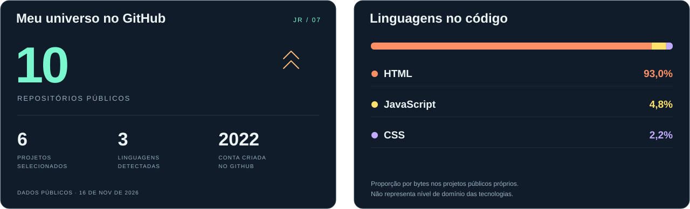
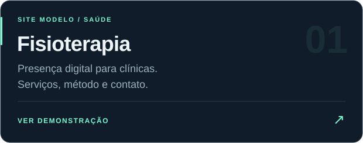
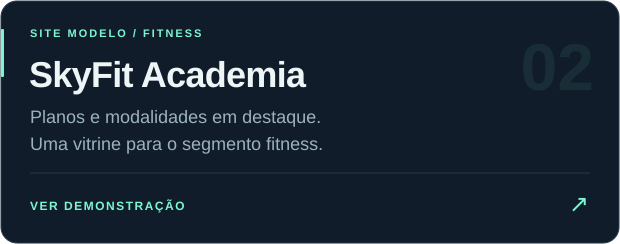
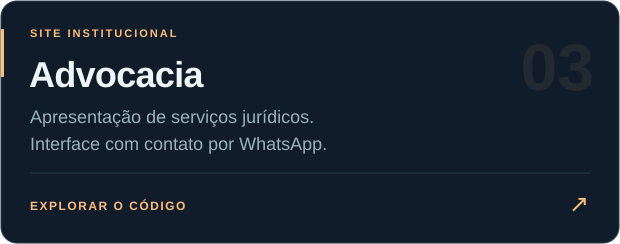
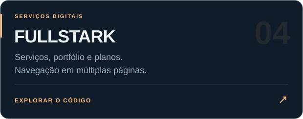
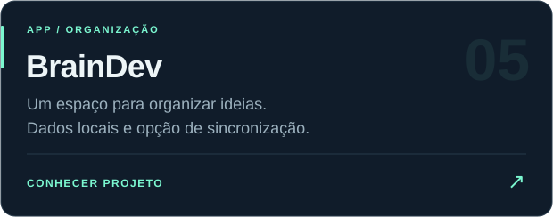
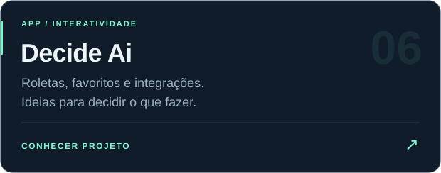
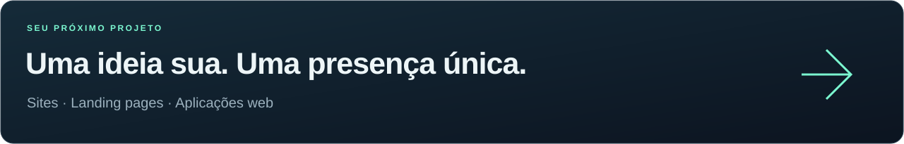

<picture>
  <source media="(max-width: 640px)" srcset="./assets/profile-banner-mobile.svg" />
  
</picture>

 

## Prazer, João Roberto.

Sou **desenvolvedor web freelancer**. Transformo ideias em sites e interfaces para empresas e profissionais que querem se apresentar bem na internet.

Gosto de unir **design com personalidade, navegação simples e uma boa experiência no celular**. Por aqui você encontra desde sites para negócios até aplicações de organização e ferramentas interativas.

`Sites institucionais` &nbsp; `Landing pages` &nbsp; `Aplicações web`

 

## Minha caixa de ferramentas

<picture>
  <source media="(max-width: 640px)" srcset="./assets/technology-stack-mobile.svg" />
  
</picture>

 

## Meu GitHub, em números

<picture>
  <source media="(max-width: 640px)" srcset="./assets/github-stats-mobile.svg" />
  
</picture>

 

## Projetos selecionados

  <a href="https://jroberto7.github.io/FISIO-MODELO/"><picture><source media="(max-width: 640px)" srcset="./assets/project-fisioterapia-mobile.svg" /></picture></a>
  <a href="https://jroberto7.github.io/Academia-Modelo/"><picture><source media="(max-width: 640px)" srcset="./assets/project-academia-mobile.svg" /></picture></a>

  <a href="https://github.com/jroberto7/adv"><picture><source media="(max-width: 640px)" srcset="./assets/project-advocacia-mobile.svg" /></picture></a>
  <a href="https://github.com/jroberto7/FULLSTARK"><picture><source media="(max-width: 640px)" srcset="./assets/project-fullstark-mobile.svg" /></picture></a>

  <a href="https://github.com/jroberto7/BrainDev"><picture><source media="(max-width: 640px)" srcset="./assets/project-braindev-mobile.svg" /></picture></a>
  <a href="https://github.com/jroberto7/DecideAi"><picture><source media="(max-width: 640px)" srcset="./assets/project-decide-ai-mobile.svg" /></picture></a>

<b>Ver código e detalhes dos projetos</b>

| Projeto | O que ele apresenta | Código |
| --- | --- | --- |
| Fisioterapia | Serviços, etapas do atendimento e contato para uma clínica | [FISIO-MODELO](https://github.com/jroberto7/FISIO-MODELO) |
| SkyFit Academia | Planos, modalidades e apresentação da estrutura | [Academia-Modelo](https://github.com/jroberto7/Academia-Modelo) |
| Advocacia | Interface institucional com contato por WhatsApp | [adv](https://github.com/jroberto7/adv) |
| FULLSTARK | Páginas de serviços, portfólio, loja e planos | [FULLSTARK](https://github.com/jroberto7/FULLSTARK) |
| BrainDev | Organização digital, dados locais e sincronização opcional com Firebase | [BrainDev](https://github.com/jroberto7/BrainDev) |
| Decide Ai | Roletas interativas, favoritos e integrações com APIs | [DecideAi](https://github.com/jroberto7/DecideAi) |

Sites modelo são demonstrações de portfólio com conteúdo e dados de exemplo.

  

Me conte **a ideia**, **o que seu site precisa ter** e **a data desejada**. Assim podemos conversar sobre o seu projeto.

<!-- CONTACT_CTA -->
